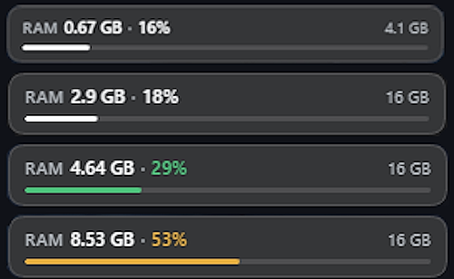

# RAM meter

Live host memory and heap-ceiling meter for [DeepSeek Harness](https://github.com/deepseek-ai/deepseek-harness),
shown as a compact pill in the Web UI.

The pill reads the **host process's own** memory every two seconds and measures its ceiling instead of
assuming one: a stock host reports its ~4 GB V8 limit, a host launched with
`--max-old-space-size=16384` reports ~16 GB, and the pill shows whichever number the running process
actually has.



```
RAM 1.4 GB · 9%
[▁▁▁▁▁▁▁▁▁▁▁▁▁▁▁▁▁▁▁▁▁▁▁▁]
```

Hovering shows the details:

```
RAM 1.4 GB of 16 GB ceiling (8.8%)
Heap 0.40 GB / 0.60 GB
PID 4242 · uptime 1h 2m
```

- **Colours**: neutral below 50%, amber from 50% to 75%, red above 75%.
- **Failure**: when the route cannot be read the pill shows `—` and retries on the next tick. It never
  throws and never writes to the browser console.

## Install

```sh
dsh plugin --profile <name> add @npmghost/dsh-ram-meter
```

Or, from a packed tarball, inside the profile directory:

```sh
pnpm add ./npmghost-dsh-ram-meter-0.1.0.tgz
```

Then add the bundle to the profile's `dsh.profile.bundles` list — Plugin Manager's **Add plugin**
does both steps for you — and restart the host so the Client loads the new bundle generation.

Requirements: DeepSeek Harness `>=0.2.2-rc.2 <0.3.0` (the `engines.dsh` field). The package has no
runtime dependencies: the Host half imports only `node:v8`, and the Client half receives React from
the page's module table.

## Configuration

The plugin row in a profile's `cordis.patch.yml` accepts two keys:

```yaml
- id: ram-meter
  name: '@npmghost/dsh-ram-meter'
  config:
    refreshIntervalMs: 2000   # 500..10000, default 2000
    placement: sidebar-footer # sidebar-footer | composer-dock | floating
```

| Key | Default | Notes |
|---|---|---|
| `refreshIntervalMs` | `2000` | Clamped to `500..10000`; a malformed value falls back to the default. |
| `placement` | `sidebar-footer` | `sidebar-footer` → `sidebar.footer.action`, `composer-dock` → `conversation.composer.dock`, `floating` → `shell.overlay`. |

The values are validated by the plugin's `Config` (a Standard Schema object) when the row activates,
and the same resolution is clamped again in the Client, so a stale profile patch cannot produce a
hostile cadence. Changing the placement takes effect on the next configuration refresh (within 30 s)
without a reload.

## Host routes

| Route | Response |
|---|---|
| `GET /dsh-ram` | `{ rss, heapUsed, heapTotal, heapLimit, uptimeSec, pid }` |
| `GET /dsh-ram/config` | `{ refreshIntervalMs, placement }` |

Both are exact-path, loopback-only, `cache-control: no-store`, and answer `403` to a non-loopback
peer and `405` to any method other than `GET`.

`heapLimit` is `v8.getHeapStatistics().heap_size_limit` of the host process — the same number the
pill divides by. `rss` is `process.memoryUsage().rss`.

## Development

```sh
npm install
npm run build      # tsdown → lib/index.js (Host) + lib/client.js (Client script)
npm run typecheck
npm test           # unit, route and polling-store tests (vitest)
npm run test:e2e   # headless Edge over CDP against a scratch profile
```

`lib/index.js` is ESM and exports `apply`, `inject` and `Config`. `lib/client.js` is a plain script
with no module syntax: it registers a lazy factory in `window.__ModuleLoader__` whose id is the
package name, and its only module request is `react`.

## Limitations

- `composer-dock` maps to `conversation.composer.dock`, which DSH renders only inside an open
  conversation. The landing page has no conversation, so with that placement the pill appears once a
  session with a composer is open — it is not visible on the start screen. `sidebar-footer` and
  `floating` are visible everywhere.
- The pill has 11 px of text; long localized words are not wrapped.
- The `floating` placement sits above the frame's overlay layer, so another overlay plugin may
  render above it.
- The colour bands are exercised by unit tests; a host that never crosses 50% will not show amber or
  red in normal use.

## License

MIT © npmghost
